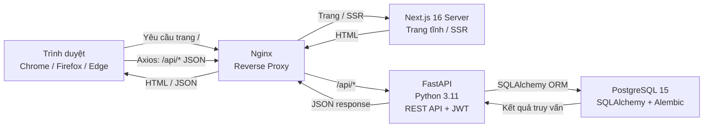
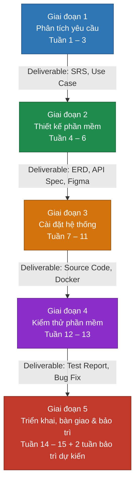

# PROJECT PROPOSAL

**Môn học:** Nhập môn Công nghệ Phần mềm  
**Tên dự án:** DevConnect – Nền tảng chia sẻ kiến thức công nghệ và bài viết kỹ thuật  
**Quy trình phát triển:** Waterfall (Thác nước)  
**Học kỳ:** 1, Năm học 2026–2027  

---

## Mục lục

1. [Bảng đánh giá thành viên](#1-bảng-đánh-giá-thành-viên)
2. [Phát biểu bài toán sơ lược](#2-phát-biểu-bài-toán-sơ-lược)
3. [Giải pháp đề xuất](#3-giải-pháp-đề-xuất)
   - [3.1. Phần mềm](#31-phần-mềm)
   - [3.2. Phần cứng](#32-phần-cứng)
4. [Kế hoạch phát triển](#4-kế-hoạch-phát-triển)
5. [Kế hoạch nhân sự & chi phí](#5-kế-hoạch-nhân-sự--chi-phí)

---

## 1. Bảng đánh giá thành viên

| MSSV | Họ Tên | Vai trò & Phân công | % Đóng góp | Chữ ký |
|:---:|:---|:---|:---:|:---:|
| 24120218 | Nguyễn Đức Quân | Trưởng nhóm – Kiến trúc hệ thống, Database design, module Auth & Quản lý người dùng | 100% | Quân |
| 24120486 | Trần Nhật Trường | Backend Developer – API Bài viết, Series, Tag, tính năng tìm kiếm | 100% | Trường |
| 24120245 | Trần Lê Đức Việt | Frontend Developer – UI/UX (Next.js + Tailwind), ByteMD Editor, giao diện responsive | 100% | Việt |
| 24120205 | Trần Văn Nguyên | Fullstack & QA – Bình luận, Vote, Bookmark, Test Cases & kiểm thử chức năng | 100% | Nguyên |
---

## 2. Phát biểu bài toán sơ lược

### 2.1. Bối cảnh và Thực trạng

Trong thời đại bùng nổ của ngành Công nghệ Thông tin, cộng đồng lập trình viên Việt Nam ngày càng có nhu cầu lớn trong việc chia sẻ kiến thức, kinh nghiệm và bài viết kỹ thuật. Tuy nhiên, các nền tảng hiện có như Facebook hay blog cá nhân không được thiết kế chuyên biệt cho nội dung kỹ thuật, dẫn đến nhiều khó khăn trong thực tế:

- **Không có syntax highlighting:** Khi tác giả chia sẻ đoạn mã nguồn, code bị dán thô mà không có tô màu cú pháp, rất khó đọc.
- **Không có chuỗi bài học:** Khi muốn viết một loạt bài liên quan (ví dụ: "Học Docker từ A–Z"), tác giả không có cách gom chúng thành một chuỗi có thứ tự rõ ràng.
- **Khó tìm kiếm theo chủ đề:** Không có hệ thống phân loại bài viết theo nhãn (tag) chuyên biệt, khiến người đọc khó lọc bài theo công nghệ quan tâm.

### 2.2. Mục tiêu của Hệ thống

Dự án **DevConnect** được xây dựng nhằm cung cấp một nền tảng web chuyên biệt phục vụ nhu cầu viết và đọc tài liệu kỹ thuật. Hệ thống hướng đến các mục tiêu:

- **Trình soạn thảo Markdown tích hợp:** Hỗ trợ cú pháp Markdown (GFM) với thư viện ByteMD, cho phép xem trước (live preview) và tô màu cú pháp code ngay trên trình duyệt.
- **Tổ chức nội dung theo chuỗi (Series):** Tác giả gom nhiều bài viết thành một Series học tập có thứ tự.
- **Phân loại theo chủ đề (Tags):** Người dùng gắn nhãn thẻ chủ đề, người đọc lọc bài theo tag quan tâm.
- **Tương tác cộng đồng cơ bản:** Bình luận (2 cấp), vote thích/không thích, bookmark bài viết yêu thích.

### 2.3. Nghiệp vụ Chính

| Nhóm nghiệp vụ | Mô tả |
|:---|:---|
| Quản lý tài khoản | Đăng ký, đăng nhập, cập nhật thông tin cá nhân. Mọi người dùng có thể đọc bài Published; tài khoản đã đăng nhập mặc định có quyền Tác giả để tạo và quản lý bài của mình; quyền Admin được cấp riêng qua cấu hình khởi tạo. |
| Quản lý bài viết | Soạn thảo Markdown, lưu nháp (Draft), xuất bản (Published), chỉnh sửa, xóa bài |
| Series & Tags | Tạo và quản lý chuỗi bài viết; gắn tối đa 5 tags cho mỗi bài |
| Tương tác | Bình luận 2 cấp, vote (upvote/downvote), bookmark bài viết |
| Tìm kiếm | Tìm bài theo tiêu đề hoặc lọc theo tag; kết quả phân trang |
| Quản trị | Admin ẩn/xóa bài vi phạm, quản lý danh mục tags |

### 2.4. Môi trường Hoạt động và Ràng buộc

- **Phía máy khách (Client):** Trình duyệt web hiện đại hỗ trợ HTML5 và JavaScript ES6+ (Chrome, Firefox, Edge). Giao diện responsive, hiển thị tốt trên máy tính và điện thoại.
- **Phía máy chủ (Server):** Ubuntu Server 24.04 LTS. Các dịch vụ đóng gói bằng Docker & Docker Compose. Nginx đóng vai trò reverse proxy.
- **Ràng buộc kỹ thuật:** Giao tiếp Client–Server qua REST API (JSON). Quản lý phiên bản mã nguồn bằng Gitflow. Quản lý schema cơ sở dữ liệu bằng Alembic. Tài liệu hóa theo chuẩn UML 2.0.

---

## 3. Giải pháp đề xuất

### 3.1. Phần mềm

#### 3.1.1. Danh sách các chức năng phần mềm

Nhóm sử dụng bảng User Story để lý giải sự cần thiết và phạm vi triển khai của từng chức năng:

| # | Tác nhân | Nhu cầu | Yêu cầu / Mô tả chức năng | Mã chức năng |
|:---:|:---|:---|:---|:---:|
| US-01 | Độc giả (chưa đăng nhập) | Muốn đọc bài viết không cần tài khoản | Mọi người dùng có thể xem bài viết đã công khai (Published). Nội dung Markdown hiển thị với syntax highlighting. Không yêu cầu đăng nhập để đọc. | F-ART-01 |
| US-02 | Độc giả (chưa đăng nhập) | Muốn tìm kiếm và lọc bài theo chủ đề | Thanh tìm kiếm tìm bài theo tiêu đề (ILIKE). Người dùng lọc danh sách bài viết theo Tag. Kết quả phân trang (10 bài/trang). | F-SEARCH-01 |
| US-03 | Độc giả (đã đăng nhập) | Muốn lưu bài viết hay để đọc lại sau | Nút Bookmark trên bài viết; danh sách bookmark trong trang Profile. Người dùng có thể xóa bookmark. | F-BOOKMARK-01 |
| US-04 | Độc giả (đã đăng nhập) | Muốn vote thích/không thích bài viết | Nút Upvote 👍 và Downvote 👎 trên mỗi bài. Mỗi tài khoản chỉ có một lựa chọn trên mỗi bài và có thể đổi lựa chọn. Tổng điểm công khai được tính bằng số Upvote trừ số Downvote. | F-VOTE-01 |
| US-05 | Độc giả (đã đăng nhập) | Muốn bình luận và hỏi đáp dưới bài viết | Bình luận dưới bài viết. Hỗ trợ trả lời bình luận (tối đa 2 cấp). Tác giả bình luận có thể xóa bình luận của chính mình. | F-CMT-01 |
| US-06 | Tác giả (Author) | Muốn viết bài bằng Markdown với live preview | ByteMD Editor: bên trái gõ Markdown, bên phải xem trước HTML ngay lập tức. Hỗ trợ syntax highlighting cho Python, JavaScript, Java... Cho phép tải ảnh và chèn vào bài. | F-EDITOR-01 |
| US-07 | Tác giả | Muốn lưu bài nháp và công khai khi hoàn thiện | Bài viết có 2 trạng thái: Draft (nháp – chỉ tác giả thấy) và Published (công khai). Tác giả lưu nháp hoặc nhấn Xuất bản. Có thể chỉnh sửa hoặc đưa bài trở lại nháp. | F-ART-02 |
| US-08 | Tác giả | Muốn gom bài viết thành chuỗi học tập (Series) | Tác giả tạo Series, thêm bài viết đã xuất bản và sắp xếp thứ tự. Trang bài viết trong Series hiển thị nút Bài trước / Bài sau. | F-SERIES-01 |
| US-09 | Quản trị viên (Admin) | Muốn ẩn hoặc xóa bài viết vi phạm | Admin Panel liệt kê tất cả bài viết. Admin có thể ẩn (Hide) hoặc xóa vĩnh viễn bài vi phạm. | F-MOD-01 |
| US-10 | Quản trị viên | Muốn quản lý danh mục Tag của hệ thống | Admin tạo Tag mới (tên, màu sắc, mô tả). Chỉnh sửa hoặc xóa Tag. Cảnh báo khi tạo Tag trùng tên. | F-TAG-01 |
| US-11 | Người dùng | Muốn tạo tài khoản và quản lý hồ sơ cá nhân | Người dùng có thể đăng ký, đăng nhập, đăng xuất và cập nhật thông tin hồ sơ cơ bản. Mọi tài khoản đã đăng nhập mặc định có quyền Tác giả để tạo và quản lý bài của mình; quyền Admin chỉ được cấp cho tài khoản khởi tạo qua cấu hình, không thể tự đăng ký hoặc tự nâng quyền. | F-AUTH-01 |

**Quy tắc nghiệp vụ và tiêu chí nghiệm thu cốt lõi**

Người tạo bài viết là chủ sở hữu bài. Chỉ chủ sở hữu được sửa bài và trạng thái Draft/Published của bài đó; Draft chỉ hiển thị với chủ sở hữu. Tài khoản Admin được khởi tạo qua cấu hình triển khai và có quyền kiểm duyệt theo US-09.

| User Story | Tiêu chí nghiệm thu |
|:---:|:---|
| US-01 | Người chưa đăng nhập xem được bài Published; nội dung Draft không được trả về cho người không phải chủ sở hữu. |
| US-02 | Tìm kiếm theo tiêu đề và lọc theo Tag hoạt động đồng thời; kết quả được phân trang 10 bài/trang. |
| US-03 | Người dùng chỉ xem và xóa được bookmark của chính mình; thao tác thêm lặp không tạo bản ghi trùng. |
| US-04 | Mỗi tài khoản có tối đa một vote trên một bài; đổi lựa chọn thay vote cũ; điểm hiển thị bằng Upvote − Downvote. |
| US-05 | Bình luận tối đa hai cấp; người dùng chỉ xóa được bình luận do mình tạo. |
| US-06 | Nội dung Markdown được xem trước dưới dạng HTML; ảnh tải lên có thể được chèn và hiển thị trong bài. |
| US-07 | Draft chỉ chủ sở hữu xem được; xuất bản làm bài hiển thị công khai; chuyển về Draft gỡ bài khỏi danh sách công khai. |
| US-08 | Series hiển thị bài theo thứ tự do chủ sở hữu sắp xếp; nút Bài trước/Bài sau đi theo thứ tự đó. |
| US-09 | Chỉ Admin được ẩn hoặc xóa bài; bài bị ẩn không còn hiển thị công khai, bài bị xóa không thể truy cập lại. |
| US-10 | Chỉ Admin được quản lý Tag; tên Tag sau khi bỏ khoảng trắng đầu/cuối không được trùng, không phân biệt chữ hoa/thường. |
| US-11 | Người dùng đăng ký không thể tự cấp quyền Admin; yêu cầu đến chức năng quản trị từ tài khoản không có quyền bị từ chối. |

#### 3.1.2. Kiến trúc tổng thể phần mềm

Hệ thống DevConnect được xây dựng theo **kiến trúc 3 tầng (Three-tier Architecture)** kết hợp mô hình Client-Server. Trình duyệt gửi yêu cầu trang và REST API qua Nginx. Nginx định tuyến yêu cầu trang đến Next.js Server và yêu cầu `/api/*` đến FastAPI. Các dịch vụ được đóng gói bằng Docker.

**Luồng dữ liệu cơ bản:**

1. Trình duyệt gửi yêu cầu trang đến Nginx; Nginx chuyển yêu cầu trang/SSR đến Next.js Server.
2. Khi gọi API, giao diện trên trình duyệt gửi request JSON bằng Axios đến đường dẫn `/api/*` qua Nginx.
3. Nginx chuyển tiếp request API đến FastAPI container.
4. FastAPI xác thực JWT và quyền theo vai trò, xử lý nghiệp vụ, rồi truy vấn PostgreSQL qua SQLAlchemy.
5. JSON response đi từ FastAPI qua Nginx về trình duyệt; React cập nhật giao diện.

**Hạ tầng triển khai:**

- **Docker & Docker Compose:** Mỗi dịch vụ (Next.js, FastAPI, PostgreSQL, Nginx) chạy trong container riêng. Chỉ cần `docker compose up` là khởi động toàn bộ hệ thống.
- **Nginx:** Reverse proxy, chuyển tiếp request đến đúng container dựa vào đường dẫn URL.
- **Gitflow:** Nhánh `main` (ổn định), `develop` (phát triển), `feature/*` (từng tính năng). Mỗi tính năng tạo Pull Request, review trước khi merge.

**Tech Stack tóm tắt:**

| Tầng | Công nghệ |
|:---|:---|
| Frontend | Next.js 16 (React), TailwindCSS, ByteMD |
| Backend | FastAPI (Python 3.11), JWT Authentication |
| Database | PostgreSQL 15, SQLAlchemy ORM, Alembic |
| Infrastructure | Docker, Docker Compose, Nginx, GitHub Actions |

### 3.2. Phần cứng

| Thành phần | Máy trạm phát triển (Tối thiểu) | Máy trạm phát triển (Khuyến nghị) | Máy chủ demo (Tối thiểu) |
|:---|:---|:---|:---|
| CPU | Intel Core i5 / AMD Ryzen 5 | Intel Core i7 thế hệ 10+ | 2 vCPU (64-bit) |
| RAM | 8 GB | 16 GB | 2 GB |
| Ổ cứng | SSD 256 GB | SSD 512 GB | 20 GB trống |
| Mạng | Internet ổn định | Internet ≥ 20 Mbps | Có IP tĩnh |
| Hệ điều hành | Windows 11 hoặc macOS 14+ hoặc Ubuntu 24.04 LTS | Ubuntu 24.04 LTS | Ubuntu Server 24.04 LTS |
| Phần mềm bắt buộc | Docker Desktop (phiên bản còn hỗ trợ trên hệ điều hành sử dụng), VS Code, Git, Node.js 24 LTS, Python 3.11+ | Như bên trái + Postman, pgAdmin 4, Figma | Docker Engine, Docker Compose v2, Nginx |

> **Cơ sở chọn phiên bản (đối chiếu ngày 19/10/2026):** Next.js 16 thuộc Active LTS; Node.js 24 thuộc LTS và đáp ứng yêu cầu tối thiểu Node.js 20.9 của Next.js 16. Windows 10 đã hết hỗ trợ tiêu chuẩn; Ubuntu 20.04 đã hết hỗ trợ bảo mật tiêu chuẩn. macOS cần nằm trong các phiên bản được Docker Desktop hỗ trợ tại thời điểm cài đặt. [Next.js Support Policy](https://nextjs.org/support-policy) · [Next.js System Requirements](https://nextjs.org/docs/app/getting-started/installation) · [Node.js Releases](https://nodejs.org/en/about/previous-releases) · [Windows 10 End of Support](https://learn.microsoft.com/en-us/lifecycle/announcements/windows-10-end-of-support) · [Ubuntu Release Cycle](https://ubuntu.com/about/release-cycle) · [Docker Desktop for Mac](https://docs.docker.com/desktop/setup/install/mac-install/)

---

## 4. Kế hoạch phát triển

### Quy trình Waterfall (Thác nước)

Nhóm áp dụng mô hình phát triển **Waterfall** (Thác nước) – một quy trình tuyến tính trong đó mỗi giai đoạn phải hoàn thành trước khi chuyển sang giai đoạn tiếp theo. Mô hình này phù hợp với dự án DevConnect vì:

- Yêu cầu hệ thống đã được xác định rõ ràng và ổn định ngay từ đầu.
- Phạm vi dự án nhỏ (4 thành viên, 15 tuần), dễ lập kế hoạch tuần tự.
- Tài liệu đầu ra của mỗi giai đoạn là đầu vào bắt buộc của giai đoạn tiếp theo.

> **Ghi chú về phương pháp:** Dự án được tổ chức theo quy trình **Waterfall** gồm 5 giai đoạn tuần tự. Trong đó, ở Giai đoạn 1 (Phân tích), nhóm kết hợp áp dụng kỹ thuật **User Story** theo đúng định hướng gợi ý của mẫu đề bài nhằm thu thập và lý giải sự cần thiết của các chức năng từ góc nhìn người dùng, sau đó quy chuẩn thành tài liệu **SRS (tham chiếu ISO/IEC/IEEE 29148:2018)** và **Use Cases (UML 2.0)** làm căn cứ thiết kế và nghiệm thu cho các giai đoạn tiếp theo.

### Biểu đồ Waterfall

### Chi tiết từng giai đoạn

| Giai đoạn | Tuần | Nội dung công việc | Thành phẩm bàn giao |
|:---|:---:|:---|:---|
| **GĐ1 – Phân tích yêu cầu** | 1–3 | • Khảo sát hệ thống tương tự (Dev.to, Viblo, Hashnode) và phân tích ưu/nhược điểm • Xác định tác nhân (Actor) và liệt kê Use Cases tổng quan • Viết đặc tả Use Case chi tiết cho ≥ 8 Use Case cốt lõi • Xây dựng danh sách yêu cầu chức năng & User Stories • Xác định yêu cầu phi chức năng (hiệu năng, bảo mật cơ bản) • Thống nhất Tech Stack và phân công nhiệm vụ | ✓ Tài liệu SRS tham chiếu [ISO/IEC/IEEE 29148:2018](https://www.iso.org/obp/ui?_escaped_fragment_=iso%3Astd%3Aiso-iec-ieee%3A29148%3Aed-2%3Av1%3Aen) ✓ Use Case Diagram (UML 2.0) ✓ Danh sách User Stories & Bảng phân rã chức năng ✓ Đặc tả Use Case chi tiết (≥ 8 UC) |
| **GĐ2 – Thiết kế** | 4–6 | • Thiết kế cơ sở dữ liệu: ERD, sơ đồ quan hệ các bảng PostgreSQL • Thiết kế Class Diagram cho tầng xử lý nghiệp vụ (FastAPI services) • Đặc tả API: định nghĩa endpoint, request/response mẫu (Postman Collection) • Thiết kế giao diện: Wireframe lo-fi → Hi-fi Mockup trên Figma (toàn bộ màn hình chính) • Cài đặt môi trường Docker Compose (dev) để các thành viên chạy được | ✓ ERD & sơ đồ bảng PostgreSQL ✓ Class Diagram (tầng Service) ✓ API Spec (Postman Collection) ✓ Figma Mockup tất cả màn hình chính ✓ Docker Compose dev chạy được |
| **GĐ3 – Cài đặt** | 7–11 | • Setup dự án, cấu trúc thư mục, nhánh Git, GitHub Actions CI cơ bản • Backend: Auth API (đăng ký/đăng nhập/JWT), User API, database migrations • Backend: Article API (CRUD, Draft/Publish), Tag API, Series API • Backend: Comment API (2 cấp), Vote API, Bookmark API, Search API • Frontend: Layout chính, Auth pages, Trang chủ, Trang bài viết • Frontend: ByteMD Editor, trang soạn thảo, Series manager, Profile • Frontend: Admin Panel; kết nối Frontend ↔ Backend, sửa lỗi tích hợp | ✓ Mã nguồn Backend (FastAPI) – đủ API ✓ Mã nguồn Frontend (Next.js) – đủ màn hình ✓ Database migrations (Alembic) hoàn chỉnh ✓ Hệ thống chạy trên Docker Compose |
| **GĐ4 – Kiểm thử** | 12–13 | • Lập Test Plan cho toàn bộ 11 User Stories • Viết ≥ 30 Test Cases, bao phủ US-01 → US-11 • Viết Unit Tests bằng pytest cho các service chính (Auth, Article, Vote) • Kiểm thử API bằng Postman Collection • Kiểm thử chức năng thủ công trên Chrome và Firefox • Ghi nhận Bug Report, phân loại mức độ, sửa lỗi và Re-test | ✓ Tài liệu Test Plan ✓ ≥ 30 Test Cases ✓ Kết quả Unit Test (pytest) ✓ Postman Collection ✓ Bug Report & biên bản kiểm thử |
| **GĐ5 – Triển khai, bàn giao & bảo trì** | 14–15; bảo trì dự kiến 2 tuần sau nghiệm thu | • Cấu hình Nginx production, build Docker images, triển khai lên VPS/local server • Chuẩn bị dữ liệu mẫu (demo data) cho buổi báo cáo • Viết User Guide cho Độc giả, Tác giả và Admin • Hoàn thiện tài liệu kỹ thuật, chuẩn bị Slide báo cáo ≥ 15 slide và tập demo • Dự kiến trong 2 tuần sau nghiệm thu: tiếp nhận lỗi, phân loại, sửa lỗi mức cao và phát hành bản vá • Sao lưu dữ liệu trước khi cập nhật; bàn giao hướng dẫn phục hồi cơ bản • Nộp mã nguồn GitHub (tag v1.0.0), tài liệu và demo cuối kỳ | ✓ Hệ thống chạy ổn định (local/VPS) ✓ Docker Compose production config ✓ User Guide và hướng dẫn vận hành/phục hồi ✓ Slide báo cáo (≥ 15 slide) ✓ Bug log và bản vá trong thời gian bảo trì dự kiến ✓ Mã nguồn tag v1.0.0 trên GitHub |

---

## 5. Kế hoạch nhân sự & chi phí

### 5.1. Ma trận phân công trách nhiệm (RACI)

> **Ký hiệu:** R = Responsible (thực hiện) | A = Accountable (chịu trách nhiệm) | C = Consulted (tham khảo) | I = Informed (được thông báo)

| Giai đoạn / Nhiệm vụ | TV1 – Nguyễn Đức Quân (Trưởng nhóm) | TV2 – Trần Nhật Trường (Backend Dev) | TV3 – Trần Lê Đức Việt (Frontend Dev) | TV4 – Trần Văn Nguyên (Fullstack & QA) |
|:---|:---:|:---:|:---:|:---:|
| **GĐ1: Phân tích yêu cầu** | **A/R** | **R** | **R** | **R** |
| – Lập SRS & Use Case Diagram | A/R | C | C | R |
| – Lập danh mục yêu cầu & User Stories | A | R | R | R |
| – Khảo sát hệ thống tương tự | A/R | R | R | R |
| **GĐ2: Thiết kế phần mềm** | **A/R** | **R** | **R** | **C** |
| – Thiết kế ERD & Database Schema | A/R | C | I | C |
| – Đặc tả API endpoints | A/R | R | C | C |
| – Thiết kế UI/UX Figma | C | I | A/R | C |
| **GĐ3: Cài đặt – Backend** | **C** | **A/R** | **I** | **R** |
| – Auth & User API | A/R | R | I | C |
| – Article, Series, Tag API | C | A/R | I | C |
| – Comment, Vote, Bookmark API | I | C | I | A/R |
| – Database Migration (Alembic) | A/R | R | I | C |
| **GĐ3: Cài đặt – Frontend** | **C** | **I** | **A/R** | **R** |
| – Trang chủ, Auth, Profile | C | I | A/R | R |
| – ByteMD Editor, Trang bài viết | I | C | A/R | C |
| – Admin Panel | I | C | R | A/R |
| **GĐ4: Kiểm thử phần mềm** | **C** | **R** | **R** | **A/R** |
| – Viết Test Cases & Test Plan | A | C | C | R |
| – Unit Tests (pytest) | C | R | I | A/R |
| – Kiểm thử API (Postman) | I | R | C | A/R |
| – Bug Report & Re-test | A | C | C | R |
| **GĐ5: Triển khai & Tài liệu** | **A/R** | **R** | **C** | **C** |
| – Docker production & Nginx | A/R | R | I | C |
| – User Guide & Slide báo cáo | A/R | C | C | R |
| – GitHub tag v1.0.0 | A/R | C | C | C |

### 5.2. Dự toán chi phí dự án

> Dự toán tiền mặt là **0 VNĐ nếu nhóm đủ điều kiện sử dụng các gói miễn phí và không vượt hạn mức**. Con số này chưa gồm thiết bị sẵn có, điện/mạng, gia hạn domain sau năm đầu hoặc chi phí phát sinh khi vượt hạn mức dịch vụ.

| STT | Hạng mục | Công cụ / Dịch vụ | Gói sử dụng | Chi phí tiền mặt dự kiến | Ghi chú |
|:---:|:---|:---|:---|:---:|:---|
| 1 | Quản lý mã nguồn & CI/CD | GitHub | GitHub Free; tối đa 2.000 phút Actions/tháng theo quota của gói | **0 VNĐ** | Theo dõi quota theo chủ sở hữu repository; tiêu chuẩn runner trong repository public có điều kiện miễn phí riêng |
| 2 | Tên miền (Domain) | GitHub Student Developer Pack | Domain .tech hoặc .me miễn phí năm đầu nếu được xác minh đủ điều kiện | **0 VNĐ năm đầu** | Gia hạn sau năm đầu có thể phát sinh phí; không giả định email phải có đuôi `.edu` |
| 3 | Máy chủ demo | Oracle Cloud Always Free hoặc máy cá nhân | Ampere A1: tối đa 2 OCPU và 12 GB RAM trong hạn mức Always Free; máy cá nhân cần đạt cấu hình tối thiểu ở mục 3.2 | **0 VNĐ nếu còn trong hạn mức** | Tài nguyên miễn phí phụ thuộc quota, khu vực và khả năng cấp phát; E2.1.Micro 1 GB RAM không đáp ứng mức RAM tối thiểu của nhóm |
| 4 | Thiết kế UI/UX | Figma | Starter miễn phí; tối đa 3 file Design/Sites trong team và không giới hạn Drafts | **0 VNĐ** | Nhóm gom màn hình vào số file team được phép hoặc dùng gói Education nếu đủ điều kiện |
| 5 | Quản lý dự án | Notion | Notion Free | **0 VNĐ theo gói hiện dùng** | Xác nhận giới hạn workspace và chia sẻ trên tài khoản nhóm trước khi sử dụng |
| 6 | Kiểm thử API | Postman | Postman Free (workspace cá nhân) | **0 VNĐ** | Mỗi thành viên kiểm thử trong workspace cá nhân; Collection được export thành JSON, lưu trong repository và import khi cần. Gói Free không có shared workspace/collaboration. |
| 7 | Lưu trữ hình ảnh | Lưu file trên server `/uploads` | Tự lưu trên server | **0 VNĐ** | Đơn giản nhất cho đồ án, không phụ thuộc dịch vụ thứ 3 |
| 8 | SSL/TLS Certificate | Let's Encrypt + Certbot | Chứng thư miễn phí, cần gia hạn tự động định kỳ | **0 VNĐ** | Chỉ cần nếu triển khai VPS có tên miền thật; cần kiểm tra việc gia hạn |

**Tổng chi phí tiền mặt dự kiến: 0 VNĐ theo các điều kiện trên.** Nhóm sẽ cập nhật dự toán nếu không được xác minh gói sinh viên, vượt quota hoặc cần gia hạn dịch vụ.

**Nguồn kiểm tra giới hạn gói:** [GitHub Actions](https://docs.github.com/en/actions/reference/limits) · [Oracle Always Free](https://docs.oracle.com/en-us/iaas/Content/FreeTier/freetier_topic-Always_Free_Resources.htm) · [Figma Starter](https://help.figma.com/hc/en-us/articles/13838684089751-Starter-plan-overview) · [GitHub Student Developer Pack](https://education.github.com/pack) · [Postman Free and Solo](https://learning.postman.com/docs/administration/free-and-solo) · [Postman sharing/export options](https://learning.postman.com/docs/collaborating-in-postman/sharing/)

---

