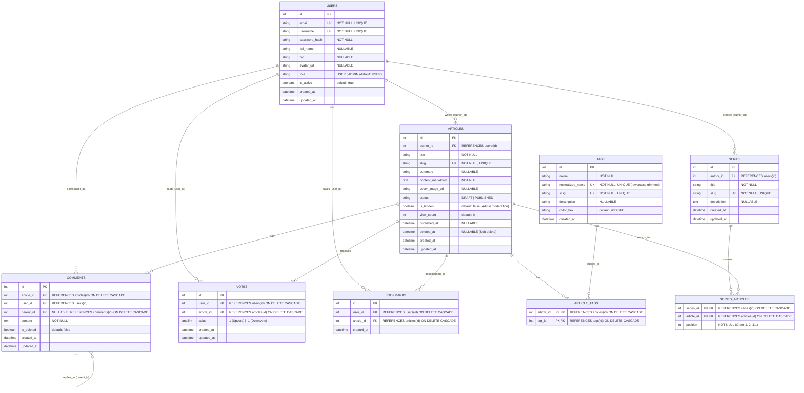
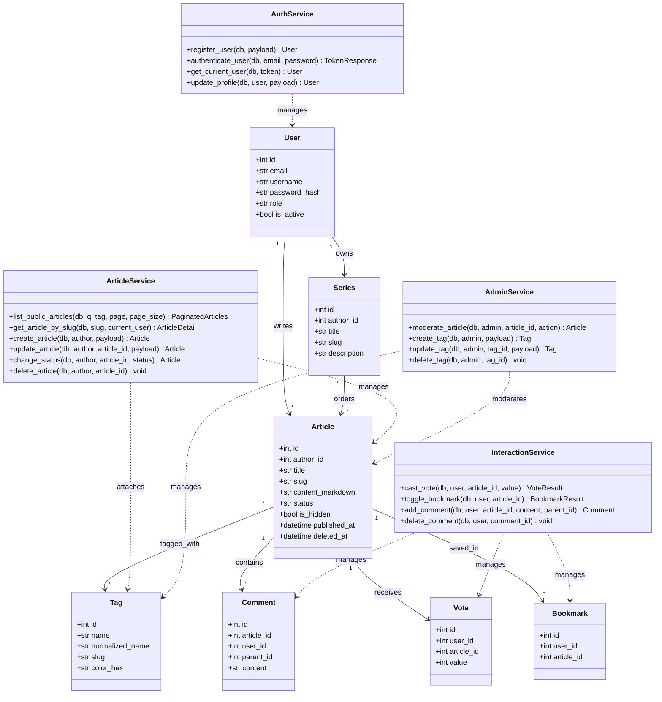
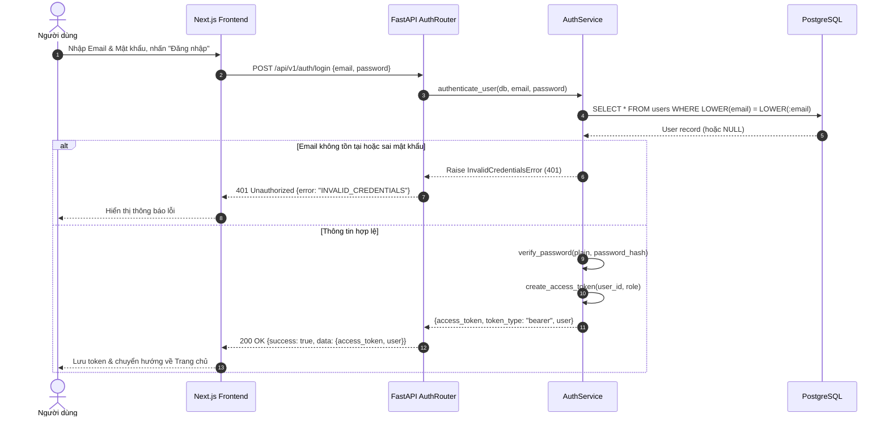
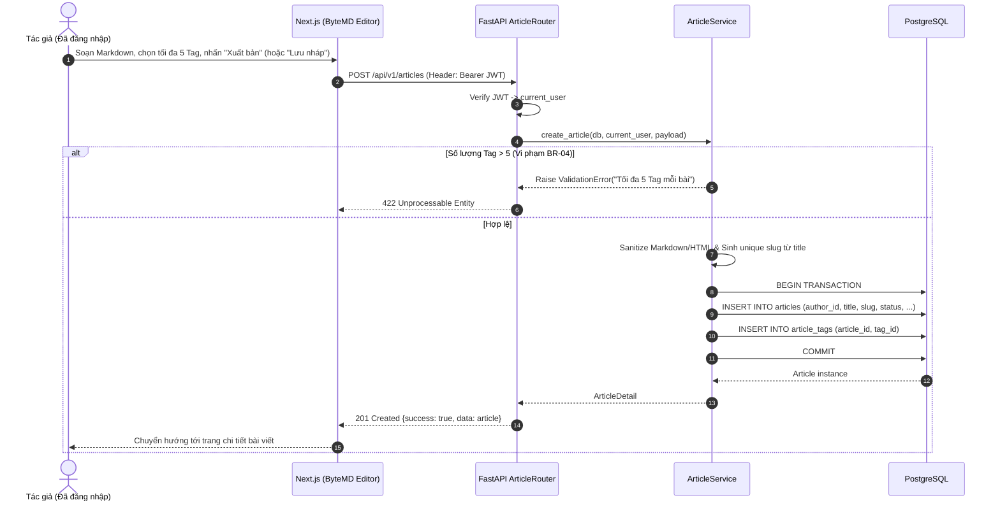
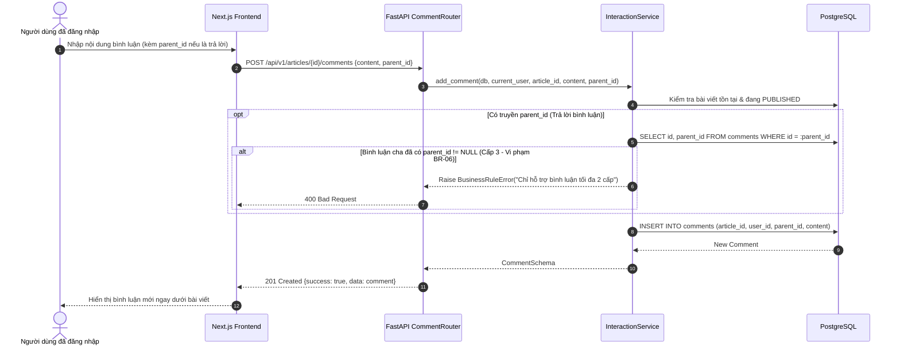
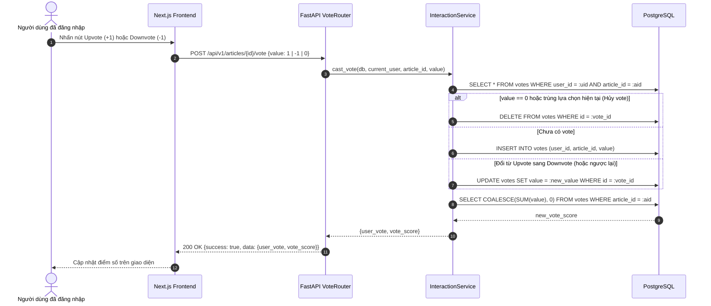

# TÀI LIỆU THIẾT KẾ HỆ THỐNG (SYSTEM DESIGN DOCUMENT)
## DevConnect – Nền tảng chia sẻ kiến thức công nghệ và bài viết kỹ thuật

**Môn học:** Nhập môn Công nghệ Phần mềm  
**Phiên bản:** 1.0  
**Trạng thái:** Baseline cho Giai đoạn Thiết kế & Cài đặt

---

## Mục lục
1. [Thiết kế Cơ sở dữ liệu (ERD & Schema)](#1-thiết-kế-cơ-sở-dữ-liệu-erd--schema)
2. [Thiết kế Lớp (Class Diagram)](#2-thiết-kế-lớp-class-diagram)
3. [Sơ đồ Tuần tự (Sequence Diagrams)](#3-sơ-đồ-tuần-tự-sequence-diagrams)
4. [Đặc tả Giao diện Lập trình Ứng dụng (API Specification)](#4-đặc-tả-giao-diện-lập-trình-ứng-dụng-api-specification)

---

## 1. Thiết kế Cơ sở dữ liệu (ERD & Schema)

### 1.1. Sơ đồ Thực thể – Liên kết (ERD)

### 1.2. Ràng buộc Toàn vẹn CSDL (Database Constraints)
Để đảm bảo tuân thủ các quy tắc nghiệp vụ `BR-01` $\rightarrow$ `BR-10` và `NFR-06`:
1. **Bảng `users`**:
   * `uq_users_email`: Unique index trên `LOWER(email)`.
   * `ck_users_role`: `role IN ('USER', 'ADMIN')`.
2. **Bảng `articles`**:
   * `ck_articles_status`: `status IN ('DRAFT', 'PUBLISHED')`.
   * Index tìm kiếm trên `(status, is_hidden, deleted_at, published_at DESC)` để tối ưu truy vấn trang chủ và tìm kiếm (`NFR-01`).
3. **Bảng `tags` & `article_tags`**:
   * `uq_tags_normalized_name`: Unique constraint trên `normalized_name` (đã `trim()` và `lower()`, đáp ứng `BR-10`).
   * Khoá chính phức hợp `PRIMARY KEY (article_id, tag_id)`. Service kiểm tra tối đa 5 tag/bài (`BR-04`).
4. **Bảng `series_articles`**:
   * `uq_series_position`: `UNIQUE (series_id, position)` đảm bảo thứ tự bài viết trong chuỗi không bị trùng (`BR-08`).
5. **Bảng `votes`**:
   * `uq_votes_user_article`: `UNIQUE (user_id, article_id)` đảm bảo mỗi user chỉ vote 1 lần trên 1 bài (`BR-05`).
   * `ck_votes_value`: `value IN (1, -1)`.
6. **Bảng `bookmarks`**:
   * `uq_bookmarks_user_article`: `UNIQUE (user_id, article_id)` đảm bảo không lưu trùng bookmark (`BR-05`).

---

## 2. Thiết kế Lớp (Class Diagram)

Sơ đồ dưới đây biểu diễn kiến trúc phân tầng của Backend (**Models $\leftarrow$ Services $\leftarrow$ Routers**):

---

## 3. Sơ đồ Tuần tự (Sequence Diagrams)

### 3.1. Luồng Đăng nhập & Xác thực JWT (US-11)

### 3.2. Luồng Tạo & Xuất bản Bài viết kèm Tag (US-06, US-07)

### 3.3. Luồng Bình luận 2 cấp (US-05 / BR-06)

### 3.4. Luồng Upvote / Downvote Bài viết (US-04 / BR-05, BR-09)

---

## 4. Đặc tả Giao diện Lập trình Ứng dụng (API Specification)

Tất cả các endpoint đều bắt đầu bằng `/api/v1`.

| Phân hệ | Method | Endpoint | Quyền | Mô tả & User Story |
|:---|:---:|:---|:---:|:---|
| **Health** | `GET` | `/api/v1/health` | Public | Kiểm tra trạng thái Backend & Database (`NFR-07`) |
| **Auth** (Quân) | `POST` | `/api/v1/auth/register` | Public | Đăng ký tài khoản mới (`US-11`) |
| | `POST` | `/api/v1/auth/login` | Public | Đăng nhập nhận JWT (`US-11`) |
| | `GET` | `/api/v1/users/me` | User | Lấy thông tin cá nhân hiện tại (`US-11`) |
| | `PATCH` | `/api/v1/users/me` | User | Cập nhật hồ sơ cá nhân (`US-11`) |
| **Articles** (Trường) | `GET` | `/api/v1/articles` | Public | Danh sách bài Published + Tìm kiếm `q` + Lọc `tag` + Phân trang (`US-01, US-02`) |
| | `GET` | `/api/v1/articles/{slug}` | Public / Owner | Xem chi tiết bài viết (`US-01`, Owner xem được `DRAFT`) |
| | `POST` | `/api/v1/articles` | User | Tạo bài viết mới (`DRAFT` hoặc `PUBLISHED` - `US-06, US-07`) |
| | `PUT` | `/api/v1/articles/{id}` | Owner | Cập nhật nội dung/trạng thái bài viết (`US-07`) |
| | `DELETE` | `/api/v1/articles/{id}` | Owner | Xóa bài viết của mình (`US-07`) |
| | `GET` | `/api/v1/me/articles` | User | Danh sách bài viết (cả `DRAFT` & `PUBLISHED`) của chính tác giả (`US-07`) |
| **Uploads** (Trường) | `POST` | `/api/v1/uploads/images` | User | Upload ảnh Markdown (PNG/JPG/WebP $\le$ 5MB - `US-06, NFR-05`) |
| **Series** (Trường) | `GET` | `/api/v1/series` | Public | Danh sách các Series học tập (`US-08`) |
| | `GET` | `/api/v1/series/{slug}` | Public | Xem chi tiết Series và danh sách bài theo thứ tự (`US-08`) |
| | `POST` | `/api/v1/series` | User | Tạo Series mới (`US-08`) |
| | `PUT` | `/api/v1/series/{id}` | Owner | Cập nhật Series & sắp xếp thứ tự bài viết (`US-08`) |
| | `DELETE` | `/api/v1/series/{id}` | Owner | Xóa Series của mình (`US-08`) |
| **Tags** (Trường) | `GET` | `/api/v1/tags` | Public | Lấy danh sách toàn bộ Tag (`US-02, US-10`) |
| **Comments** (Nguyên)| `GET` | `/api/v1/articles/{id}/comments` | Public | Lấy danh sách bình luận 2 cấp của bài viết (`US-05`) |
| | `POST` | `/api/v1/articles/{id}/comments` | User | Thêm bình luận gốc hoặc trả lời (`US-05`) |
| | `DELETE` | `/api/v1/comments/{id}` | Owner / Admin | Xóa bình luận của mình (`US-05`) |
| **Votes** (Nguyên) | `POST` | `/api/v1/articles/{id}/vote` | User | Upvote (`+1`), Downvote (`-1`) hoặc hủy vote (`0`) (`US-04`) |
| **Bookmarks**(Nguyên)| `GET` | `/api/v1/me/bookmarks` | User | Xem danh sách bài viết đã lưu (`US-03`) |
| | `POST` | `/api/v1/articles/{id}/bookmark` | User | Thêm / Bỏ lưu bài viết (`US-03`) |
| **Admin** (Trường) | `GET` | `/api/v1/admin/articles` | Admin | Liệt kê bài viết để kiểm duyệt (`US-09`) |
| | `PATCH` | `/api/v1/admin/articles/{id}/moderation` | Admin | Ẩn (`hide`), Hiện (`unhide`) hoặc Xóa (`delete`) bài vi phạm (`US-09`) |
| | `POST` | `/api/v1/admin/tags` | Admin | Tạo Tag mới (`US-10`) |
| | `PUT` | `/api/v1/admin/tags/{id}` | Admin | Sửa thông tin Tag (`US-10`) |
| | `DELETE` | `/api/v1/admin/tags/{id}` | Admin | Xóa Tag (`US-10`) |
